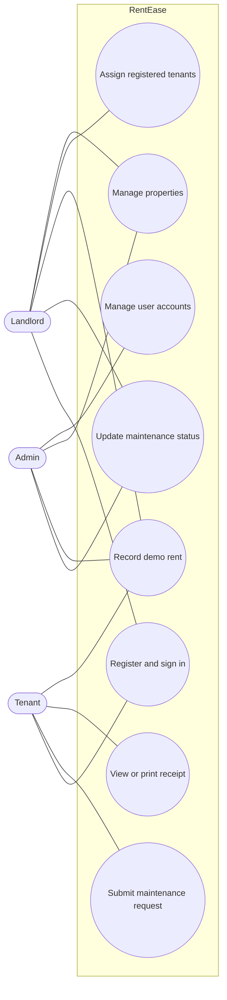
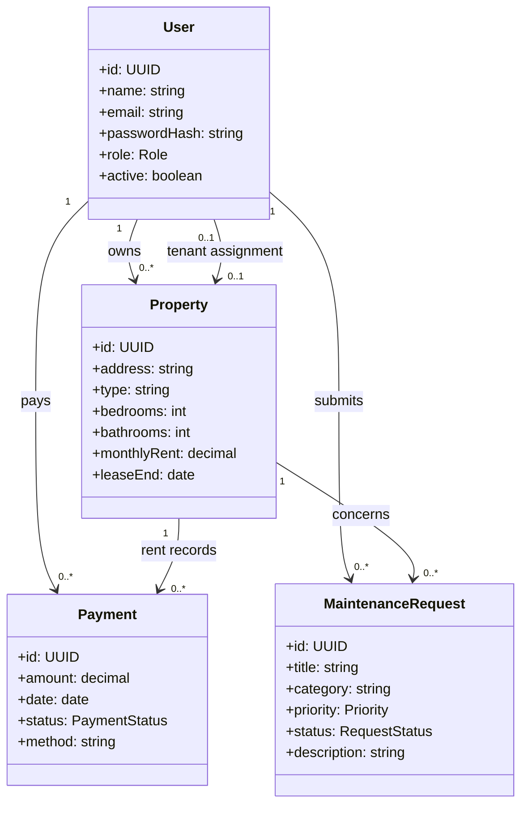
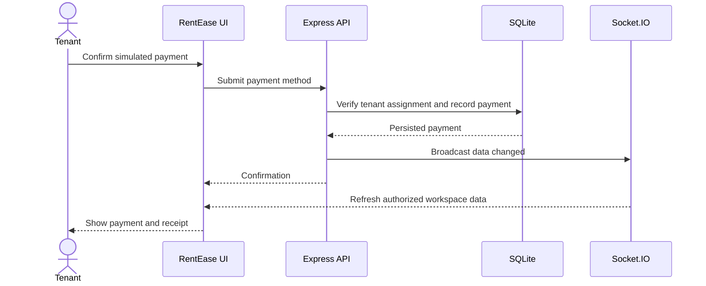
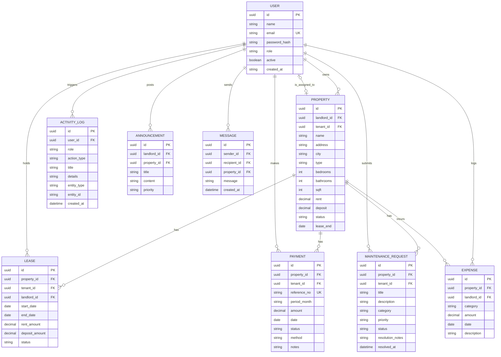
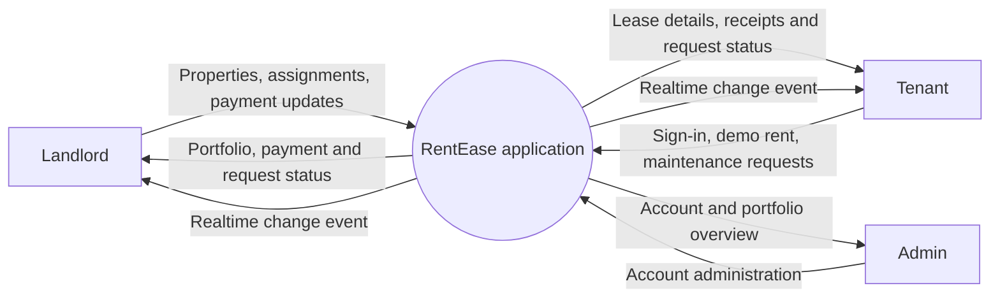
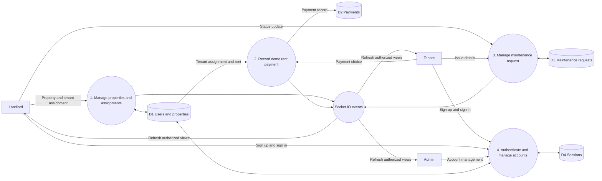

# RentEase design diagrams

These Mermaid diagrams describe the local multi-user RentEase application. A real payment provider is intentionally outside this demo; rent payment is simulated.

## Use case diagram

## Class diagram

## Rent-payment sequence

## Entity-relationship diagram

## DFD level 0 (context)

## DFD level 1

